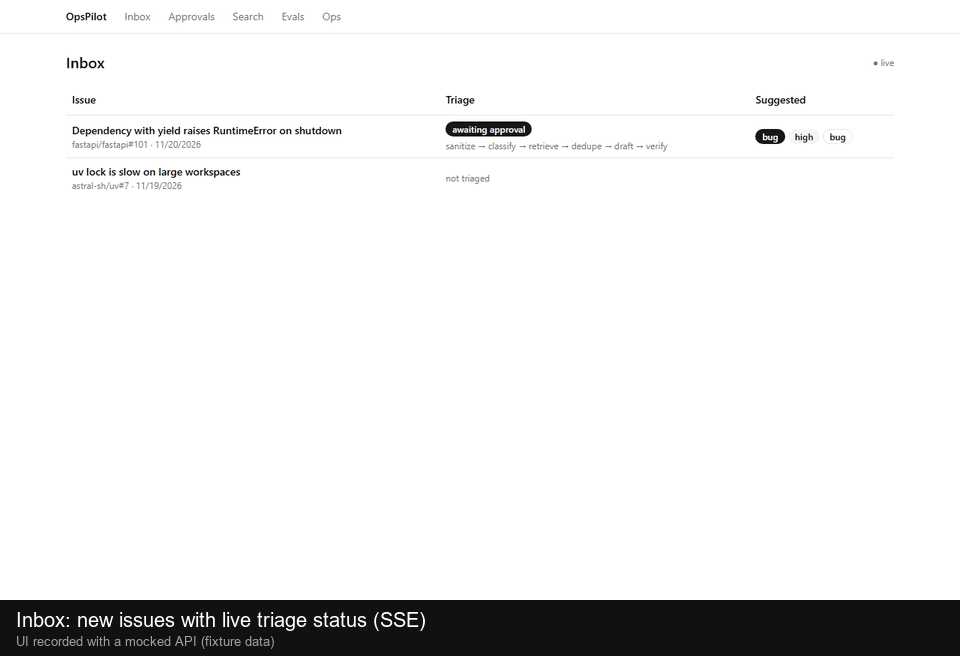
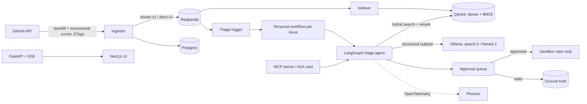

# OpsPilot

[](https://github.com/Nica880/opspilot/actions/workflows/ci.yml)

**An agentic triage and resolution copilot for open-source issue trackers, running free on a
laptop.** OpsPilot ingests public issues, PRs, discussions and docs from
[fastapi](https://github.com/fastapi/fastapi), [pydantic](https://github.com/pydantic/pydantic)
and [uv](https://github.com/astral-sh/uv). For every new issue it:

1. classifies **type** (bug / feature / question / docs), **area** and **severity**, with
   confidence;
2. finds likely **duplicates** and related past issues and PRs (hybrid search + reranking);
3. drafts a **grounded first response** where every claim cites a doc or past thread, and
   **refuses** when there is no evidence;
4. proposes **labels** from the maintainers' own vocabulary and a **reproduction checklist**;
5. sends everything to a **human approval queue**. Approved actions are applied only to a
   sandbox repo, never upstream.

It is the Forward-Deployed / Applied AI job in miniature: put an agent into a messy real workflow,
measure it, make it safe, operate it.



<sub>The demo GIF and screenshots show the real UI driven by a mocked API with fixture data
(`web/e2e/screenshots.spec.ts`), so they can be regenerated in CI without models. They are not
measured results.</sub>

## Architecture



The agent is an explicit LangGraph state machine:
`sanitize → classify → retrieve → dedupe → draft → verify (→ draft once more) → approval
(interrupt) → act`. Temporal wraps it, so a run survives restarts while it waits days for a human
decision. Details: [docs/architecture.md](docs/architecture.md).

## Run it (macOS, Apple Silicon, ≤ 5 commands)

Needs Docker (Colima), [uv](https://docs.astral.sh/uv/), Node 22 and
[Ollama](https://ollama.com) on the host.

```bash
git clone https://github.com/Nica880/opspilot && cd opspilot
cp .env.example .env   # GITHUB_TOKEN (read-only), SANDBOX_REPO (+ SANDBOX_GITHUB_TOKEN to apply approvals)
ollama pull qwen2.5:7b-instruct && ollama pull llama3.1:8b && ollama pull nomic-embed-text
make up && make demo   # small mode: ~2k issues from 3 repos, then triage of the 5 newest open issues
open http://localhost:3000   # Temporal UI :8233 · Phoenix traces :6006 · Redpanda Console :8088
```

Kubernetes mode, with the same images: `make k8s-up` creates a k3d cluster and installs Argo CD.
Argo CD then deploys KEDA, the infra chart and the app chart from this repo, and KEDA scales the
indexer and worker on Redpanda consumer lag ([ADR-011](docs/adr/0011-kubernetes.md)).

Other agents can use OpsPilot over **MCP** (`http://localhost:8000/mcp/` or stdio for Claude
Desktop) and **A2A v1.0** (`/.well-known/agent-card.json`): [docs/mcp.md](docs/mcp.md).

## Results

Every number here comes from a report in [docs/eval](docs/eval), generated by a command in this
repo; `make readme-metrics` rewrites this section from the latest reports.

<!-- metrics:start -->
**Triage quality:** not measured yet. Run `make eval` on the Mac (see [ADR-008](docs/adr/0008-evaluation.md)); this section is regenerated from the report by `make readme-metrics`.

**Duplicate retrieval:** not measured yet (`make eval-retrieval`).

**Red team** ([docs/eval/2026-11-26-redteam.json](docs/eval/2026-11-26-redteam.json)): 50/50 attacks contained with LLM provider `fake` (deterministic fake: measures the guardrails, not a model).
<!-- metrics:end -->

What is measured, and how ([ADR-008](docs/adr/0008-evaluation.md)):
- **Time split.** Issues created after a cutoff are held out. Retrieval never sees anything
  created after the issue or the cutoff, comments included.
- **Ground truth from history.**
  - Labels: the labels maintainers applied → micro/macro F1.
  - Duplicates: `Duplicate of #N` comments → recall@5, MRR.
  - Linked answers: maintainer links to docs/PRs → recall@k.
- **Answer quality.** LLM-as-judge groundedness and citation correctness, cross-judged
  (llama3.1 judges qwen2.5 and vice versa).
- **Matrix.** 2 models × 2 prompt versions × 3 retrieval variants (dense, hybrid, hybrid + rerank).
- **Ops.** p50/p95 latency, issues/hour, approval and edit rates. Cost is $0: everything is local.
- **Red team.** 50 crafted issues (10 attack families × 5 hiding places), each approved by a
  rubber-stamping reviewer, must pass 100%. CI also runs it against a deliberately *compromised*
  model that obeys the attacker.

Hardware for model runs: Apple M3 Pro, 36 GB RAM, Docker via Colima (6 CPU / 14 GB), Ollama
native on the host (Metal).

## Safety model

| Threat | Defence |
|---|---|
| Prompt injection in issue text, comments, docs | Unicode normalisation, HTML-comment/zero-width stripping, regex tripwires shown to the reviewer, `<untrusted>` delimiters; the model has **no tools** |
| Hallucinated answers | Evidence-only grounding contract; each claim carries a verbatim quote checked against its source; failing drafts are retried once, then replaced by a refusal |
| Writing to real repos | One write path (`agent/actions.py`) behind an allow-list: mirror issue, comment and allowed labels on `SANDBOX_REPO` only, after human approval |
| Phishing links, fake "I closed it" replies | Non-evidence URLs are stripped; action claims fail verification |
| Leaking secrets / PII | Redaction of tokens, keys, emails, IPs and phone numbers in every reply, comment and tool output; gitleaks in CI |
| Other agents (MCP/A2A) | Read-only tool layer with repo allow-list and bounded inputs, untrusted-content notes; an import test proves it cannot reach the write path |

## Design decisions

| ADR | Decision |
|---|---|
| [001](docs/adr/0001-stack.md) | Stack: LangGraph, Temporal, Redpanda, Qdrant, FastAPI, Next.js, Phoenix, one Postgres |
| [002](docs/adr/0002-pinned-arm64-images.md) | Exact image tags, verified for linux/arm64 without a Docker daemon |
| [003](docs/adr/0003-sql-migrations.md) | psycopg 3 + forward-only SQL migrations, no ORM |
| [004](docs/adr/0004-ingestion.md) | REST + GraphQL ingestion with ETags, rate-limit budget, backfill + cursor |
| [005](docs/adr/0005-hybrid-search.md) | Dense + BM25 with RRF, bge-reranker-base on CPU, document-level results |
| [006](docs/adr/0006-agent-design.md) | Explicit graph, evidence-first structured outputs, deterministic critic |
| [007](docs/adr/0007-temporal-langgraph.md) | Temporal workflow per issue around LangGraph interrupts |
| [008](docs/adr/0008-evaluation.md) | Evaluation methodology and the honesty rule |
| [009](docs/adr/0009-frontend.md) | Next.js client views, SSE run stream, mocked-API E2E |
| [010](docs/adr/0010-mcp-a2a.md) | MCP + A2A v1.0 over one safe tool layer |
| [011](docs/adr/0011-kubernetes.md) | k3d, own Helm charts, Argo CD app-of-apps, KEDA on consumer lag |

## Development

| Command | What |
|---|---|
| `make lint` | ruff, mypy strict, ESLint, Prettier, tsc |
| `make test` | pytest (fake LLM, recorded GitHub fixtures, in-memory Qdrant, Temporal test server) + Vitest |
| `cd web && npm run e2e` | Playwright against the production build with a mocked API |
| `make eval` / `make eval-full` | triage matrix on held-out issues → `docs/eval/` |
| `make redteam` / `make promptfoo` | red-team set and promptfoo suite against the real model |
| `make k8s-lint` | helm lint + kubeconform with CRD schemas |

CI runs the same checks on every push: lint, types, unit, evals on fixtures, red team, promptfoo,
Playwright, compose validation, Helm checks, gitleaks.

```
agent/       LangGraph graph, prompts (versioned), schemas, guardrails, providers, tools
api/         FastAPI app, SSE, MCP server, A2A endpoint
common/      settings, Postgres pool, migrations, tracing
evals/       harness, judge, red-team set, promptfoo suite
indexing/    chunking, embeddings, BM25, reranker, Qdrant, search
ingestion/   GitHub client, backfill/incremental/docs/discussions, events
workflows/   Temporal workflow + activities, Redpanda consumers
web/         Next.js app
deploy/      Helm charts, Argo CD apps, k3d config
tests/       unit, integration, fixtures (recorded GitHub responses)
```

## Data and licenses

Only public GitHub data is ingested, with a read-only token and conditional requests that respect
the rate limits. The license of every source repo is stored in the `repos` table (MIT, MIT,
Apache-2.0 at the time of writing); issue text belongs to its authors. OpsPilot never comments,
labels or posts anywhere except `SANDBOX_REPO`.

OpsPilot's own code is MIT licensed.
