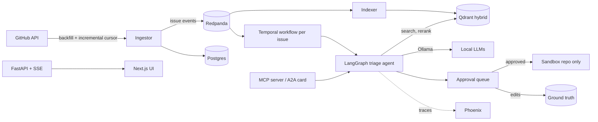

# Architecture

## Components

| Component | Code | Runs as |
|---|---|---|
| Ingestor | `ingestion/` | `python -m ingestion.cli backfill/incremental` (one-shot jobs) |
| Indexer | `indexing/` | Redpanda consumer `python -m workflows.consumers indexer` |
| Triage trigger | `workflows/consumers.py` | Redpanda consumer that starts one Temporal workflow per new issue |
| Triage workflow | `workflows/triage.py` | Temporal worker `python -m workflows.worker` |
| Agent | `agent/graph.py` | LangGraph graph called from Temporal activities |
| API | `api/` | FastAPI on :8000 (REST, SSE, MCP over streamable HTTP, A2A card) |
| UI | `web/` | Next.js on :3000 |

## Ports (compose)

| Service | Port |
|---|---|
| API | 8000 |
| Web | 3000 |
| Postgres | 5432 |
| Qdrant | 6333 (HTTP), 6334 (gRPC) |
| Redpanda | 19092 (Kafka, host), 9644 (admin) |
| Redpanda Console | 8088 |
| Temporal | 7233 (gRPC), UI on 8233 |
| Phoenix | 6006 (UI + OTLP HTTP), 4317 (OTLP gRPC) |
| Ollama (host) | 11434 |
